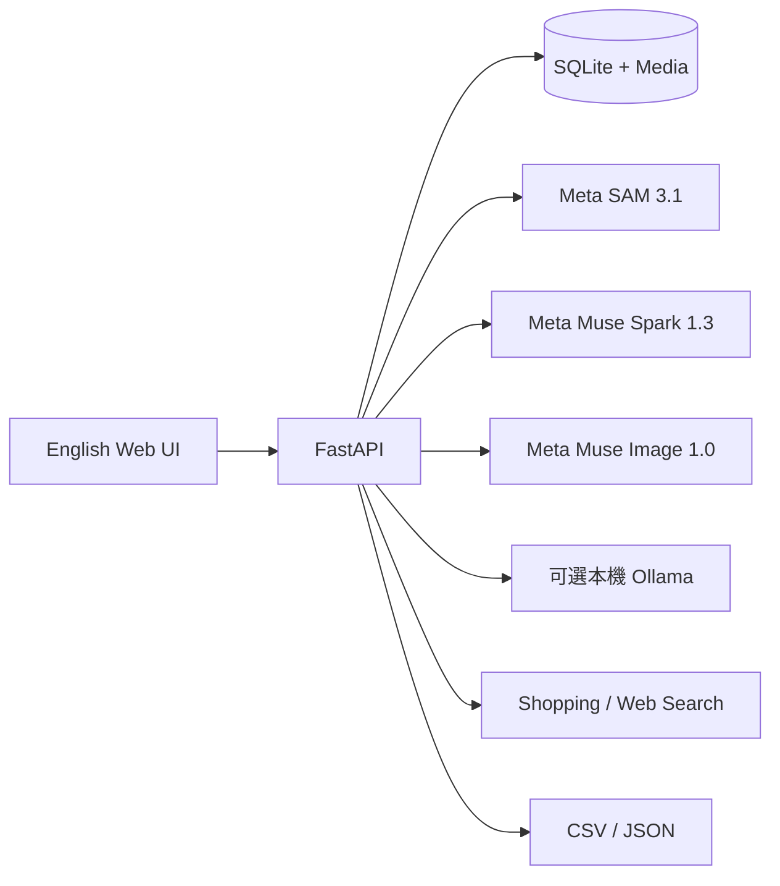

# 衣序 Rewear Studio — Meta Hackathon 交付稿

> 本文件是可直接取材的本機交付稿，尚未送出。活動為 Meta Global AI Developer Hackathon 2026（與 Cerebral Valley
> 合辦），在 Cerebral Valley 平台提交，截止為美東 11/4 21:00（台灣 11/5 10:00；美國 11/1 已結束夏令時間）。
> 正式規則以參賽者後台接受的 Official Rules 為準。

## 標題與一句話

**Rewear Studio — See It. Find It. Buy It.**

從任何生活照、街拍或短片，一鍵辨識每件穿搭，直接連到購買頁面。
Turn any life photo or street style shot into a shoppable outfit breakdown, powered by Meta AI.

## 活動期間完成的工作 / Built During the Hackathon

**活動前（10/21–10/23）為前置準備：** 分割 → 衣物判讀 → 預覽流程與網站模式的早期原型，以及內部品質基準。
影片引用的 100 張基準數字（辨識 90/100、忠實預覽 85/100）來自 10/23 的前置準備。

**活動期間（10/26–11/4）完成：** 影片中使用者看到的產品體驗，都是活動期間新做或重做的：

- 兩步驟流程：Take a photo／Import photos → Meta AI 自動分析 → 「N pieces found」→ Shop similar；手機由下滑出的
  衣物詳情；照實說明的錯誤狀態（含 Meta API billing）。
- 依 30 張街拍實測改善結果品質：同件只顯示一次、無法辨識的碎片不進結果、具體款式名稱帶出更準的購物搜尋。
- **Rewear for Chrome（Shop this look）**：全新的瀏覽器擴充功能，把動態牆上點選的一張照片交給 Rewear（`extension/`）。
- 以真實 SAM 3.1、Muse Spark 1.3、Muse Image 1.0 實測，以及 12 項真實瀏覽器端對端測試（其中 2 項操作擴充功能）。
- 評審試用網站的防濫用設定：主辦方發放的帳號、每帳號每日費用上限。
- 有旁白的 Demo 影片與可重建的製作流程（`media/production/`）。

量化：`wardrobe/` 33 個原始檔中 22 個、測試 48 個檔中 30 個在活動期間修改或新增，`extension/` 全部是新的。
提交表單若有「活動期間做了什麼」欄位，可直接貼上 README 的英文版本。

## 問題 / Problem

You spot a perfect outfit — in a street photo, a friend's Instagram, your own vacation pics. How do you find where to buy each piece?

Reverse image search gives you "similar" results that rarely match. Manual searching by description is slow and imprecise. And no tool tells you honestly which parts it actually identified versus which parts it guessed.

## 解法 / Solution

Rewear Studio turns any photo into an instant, shoppable outfit breakdown:

1. **See it** — Upload any photo (street style, group shot, selfie, or 30-sec video). SAM 3.1 precisely segments each visible garment with pixel-level masks.
2. **Find it** — Muse Spark extracts structured attributes: category, colors, pattern, fabric, brand clues from visible logos. Muse Image generates three full-garment preview candidates.
3. **Buy it** — Instantly generates shopping links across Google Shopping, Bing, and web search. Optional AI-powered product page verification with visual matching finds exact or similar items.

What makes Rewear different: we separate what the AI actually sees from what it guesses. Shopping results that don't pass visual matching aren't shown as matches. Zero false positives auto-published.

## 為什麼值得做 / Why It Matters

Every photo contains shopping intent. Rewear turns passive photo browsing into active product discovery — the exact signal Meta's commerce and advertising platforms are built to serve. Every outfit identified is a potential ad impression, product discovery, or purchase conversion.

For users: finally answer "where can I buy that?" from any photo.
For Meta: native shopping intent extraction from the photo feed — at scale.

## Meta AI 的使用方式

| 能力 | 產品用途 | 安全界線 |
| --- | --- | --- |
| Meta SAM 3.1 | 生活照、多件照與影片中的衣物分割／追蹤 | 只有真實遮罩能建立候選；框線或模型文字不能冒充衣物像素 |
| Meta Muse Spark 1.3 | 結構化衣物欄位、可見品牌線索、可選商品發現 | 未確認品牌不寫回確定欄位；商品頁仍需圖片、款式、地區核對 |
| Meta Muse Image 1.0 | 從原圖及衣物區域重新生成三張完整展示候選 | 一律標示 AI 預覽與推測；原圖永久並排；不以生成圖辨識品牌 |

預設低成本重建是一次 Muse Image 請求產生三張候選，標準費率估算約 **US$0.03／件**。固定 100 張工程基準中，目前程式跑一次分析並替 91 個自動辨識目標都產生三候選，估計約 **US$5.43／100 張**，平均 **US$0.0543／輸入**。這是依保存用量計算的工程估值，不是定價保證。

## Codex 如何參與開發

Codex 用於需求拆解、FastAPI 與原生前端實作、資料模型與帳號隔離、測試與容器驗證、100 張固定生活照基準、失敗案例逐張檢查，以及把每次模型用量、輸入、候選與人工判定保存為可稽核證據。改善過程保留失敗案例，不用替換圖片、改挑同張照片中較容易的衣物，或用模型自評代替原圖目視。

## 主要功能

- 單件、多件、生活穿搭與 30 秒內短片匯入；每批最多 32 檔。
- 合照人物框選、衣物分割、可見性品質分級與補拍引導。
- 三張完整衣物預覽、原圖／辨識區域比較、人工選圖與來源履歷。
- 多張原照的同件人工合併與可逆取消，不跨帳號、不使用生成圖當來源。
- 品牌線索、免費購物搜尋、可選 AI 商品頁核對與外部 Lens 手動交接。
- 搜尋、篩選、編輯、確認、CSV／JSON 匯出、工作取消／重試／刪除。
- 本機模式，以及具 Argon2id、CSRF、帳號／媒體隔離、容量准入與備份還原的網站模式。
- 伺服器端憑證、隱私安全的模型費用帳本與清楚的資料傳送提示。
- Chrome 擴充功能「Shop this look」：瀏覽任何網頁（含社群動態）時把滑鼠移到穿搭照片上按一下，只把那一張照片交給 Rewear 分析；不背景掃描、不傳網址或帳號。

## 架構摘要



應用以 Python 3.12、FastAPI、Pydantic、SQLite、原生 HTML/CSS/JavaScript 建置。交付包含 wheel、sdist、Linux arm64 非 root 唯讀容器、Caddy HTTPS 設定與單程序網站模式。

## 可核對成果

固定 100 張 Pexels 生活照在推論前凍結來源、目標與錨點，失敗不得換圖或換衣物：

- 同一固定目標直接稽核辨識：**90/100**。
- 有足夠原圖證據可評估完整重建：**87/100**。
- 忠實完整衣物：由基線 **75/100** 改善至 **85/100**。
- 正確辨識目標中的保真率：**85/90（94.4%）**。
- 可重建來源中的保真率：**85/87（97.7%）**。
- 全部輸入的嚴格端到端率：**85/100**；未達整體 90%，不可換分母宣稱達標。
- 非通過結果：9 件漏辨識、1 件混合遮罩、3 件來源不足、2 件生成失真。
- **0 件**失敗或不確定候選被自動發布。

這是搜尋分層便利樣本的工程回歸，不是一般生活照母體抽樣。完整逐案證據見
[100 張最終報告](../out/verification/reconstruction/web100-final-manifests-20261023/FINAL_100_PHOTO_REPORT.md)。

## 驗證與執行方式

最終程式證據包含：

- **1,591 passed**，0 failures／errors／skips（2026-11-03 英文化與簡化介面後重新驗證）。
- Ruff、格式及三份 JavaScript（app、i18n、auth）語法檢查通過。
- wheel 在專案外隔離安裝與 14 項功能煙霧測試通過。
- 來源、wheel 與 Linux arm64 映像內 38 個套件檔完全一致。
- HTTPS、Secure cookie、CSRF、兩帳號隔離、容量、重啟、備份還原與 UI 契約共 **140 項**容器檢查通過。
- 四組實際服務重啟前後穩定檔案與媒體雜湊一致。
- 最新桌機 1440px、手機 390px 唯讀介面檢查通過，無水平溢位、console error 或 page error。

本機啟動：

```sh
uv sync --extra dev
uv run rewear
```

打開 <http://127.0.0.1:8765>。手機實測改用 `uv run rewear --lan`，用手機開啟終端機印出的區網網址
（本機模式沒有登入，只在信任的 Wi-Fi 使用）。完整部署與備份流程見[網站模式與維運](HOSTED_OPERATIONS.md)，所有證據入口見[驗證紀錄](VERIFICATION.md)。

### 2026-11-03 簡化介面

首頁只剩兩個入口：**Take a photo**（手機直接開相機）與 **Import photos**（一次最多 32 張）。選好照片即自動
分析，顯示含原圖與掃描動畫的進度卡；完成後以「N pieces found」橫幅呈現這次結果，每件衣物卡片附
**Shop similar**（免費 Google Shopping 搜尋，不呼叫模型）。服務錯誤會照實顯示原因與「Try again」，
不再誤報成照片不清楚。

點開衣物後只看到大圖、名稱、顏色／花色／材質，以及一顆「Shop similar on Google」（另有 Bing、Web）；
Meta AI 精準比對、Muse Image 完整預覽與編輯收在預設收合的「More」。手機上詳情由下往上滑出、點外側即關閉；
往下瀏覽時右下角出現相機按鈕，一鍵拍下一套。分析進行中只更新有變動的卡片，不再整片重繪閃爍。

**即時分析已恢復（2026-11-03 15:24）：** 先前 Meta API 金鑰所屬團隊 billing 未設定，SAM／Spark 一律回
HTTP 402 `billing_not_configured`；帳號擁有者處理後，真實 SAM 3.1、Muse Spark 1.3 與 Muse Image 1.0 全流程
已用實際介面跑通：單張穿搭照約 17–31 秒出結果、AI 完整預覽再約 40–70 秒完成（見[驗證紀錄](VERIFICATION.md)）。
若之後又出現「billing is not set up」，畫面會照實顯示，需再到 dev.meta.ai 的 Billing 頁面處理。

## 3-Minute Demo Script

1. **0:00–0:30** — Hook: "You see a great outfit on the street. You want to buy it. How?" Show the pain point with a real street style photo.
2. **0:30–1:30** — Live demo: Upload street photo → SAM segments each piece in real-time → attributes identified → "Shop This Look" shows shopping links for every item. Show the full See→Find→Buy journey.
3. **1:30–2:15** — Technical depth: Three Meta models working together (SAM 3.1 → Spark → Muse Image). Show AI honesty: original vs preview side-by-side, speculation labeling. 100-photo benchmark: 85% faithful end-to-end.
4. **2:15–2:45** — Business angle: Every photo = shopping intent. This is native product discovery for Meta's commerce platform. Show potential Instagram/Facebook integration.
5. **2:45–3:00** — Closing: Working product, 1,610 tests, three Meta models, open source. "See it. Find it. Buy it."

**成片（2026-11-03）：** [`submission/`](../submission/README.md) 的 `rewear-demo.mp4`（1:41，1920×1080，英文旁白，內含英文字幕軌），
另有字幕燒在畫面上的 `rewear-demo-subtitled.mp4`、YouTube 用的 `rewear-demo.en.srt` 與擴充功能 `rewear-chrome-extension.zip`。
結構：街頭 POV 拍照 → Meta AI 掃描 → 1 件洋裝 → 購物頁；「They're in your feed」→ Chrome 擴充功能在示範動態牆對朋友合照按
Shop this look → Rewear 即時分析出 8 件 → Muse Image 預覽 → 詳情購物連結；三模型運作（真實 SAM 3.1 遮罩、Spark 欄位與 Muse 預覽）
→ 商業價值 → 測試與誠實設計 → 結尾。擴充功能段為實錄（真實 Meta 模型），等待以 20× 標示加速。製作流程與原始素材在
[`media/production/`](../media/production/README.md)，早期版本在 `media/archive/`。

最初的分鏡腳本見 [demo-script.md](../demo-script.md)；成片的實際結構與旁白以 [`submission/README.md`](../submission/README.md) 為準。

## 已備妥的截圖

2026-11-03 簡化介面：

- [桌機首頁：拍照／匯入兩個入口](../out/verification/simple-flow-20261103/screenshots/desktop-start.png)
- [桌機分析中進度卡](../out/verification/simple-flow-20261103/screenshots/desktop-analyzing.png)
- [手機首頁](../out/verification/simple-flow-20261103/screenshots/mobile-start.png)
- [手機批量匯入分析中](../out/verification/simple-flow-20261103/screenshots/mobile-bulk-analyzing.png)
- [桌機範例結果與 Shop similar](../out/verification/simple-flow-20261103/screenshots/desktop-sample-result.png)
- [桌機衣物詳情](../out/verification/simple-flow-20261103/screenshots/desktop-detail.png)
- [手機衣物詳情（下滑式面板）](../out/verification/simple-flow-20261103/screenshots/mobile-detail-sheet.png)
- [手機瀏覽時的浮動相機按鈕](../out/verification/simple-flow-20261103/screenshots/mobile-finds-floating-camera.png)
- [服務錯誤照實呈現（billing 402）](../out/verification/simple-flow-20261103/screenshots/desktop-billing-error.png)

先前版本：

- [桌機衣物室](../out/verification/final-hackathon-closeout-20261023/screenshots/desktop-catalogue.png)
- [原圖與完整 AI 預覽並排](../out/verification/final-hackathon-closeout-20261023/screenshots/desktop-item-detail.png)
- [390px 手機衣物室](../out/verification/final-hackathon-closeout-20261023/screenshots/mobile-catalogue.png)
- [100 張生成目視檢查範例](../out/verification/reconstruction/web100-final-manifests-20261023/generation-review-01.jpg)
- [最後九件 SAM 失敗診斷](../out/verification/lifestyle/fixtures/web-100-20261023/targeted-sam-diagnostic-20261023/review.jpg)

## 目前不可宣稱的內容

- 全部生活照都能忠實重建 90%：固定 100 張的嚴格結果是 85%。
- 已自動找到同款購買頁：固定真實基準仍是 0 個核驗通過商品。
- 已公開上線：目前只驗證 loopback 服務與隔離容器流程，尚未選定網域／主機。
- AI 預覽等於實物真值：被遮住的衣長、背面、標籤與尺寸仍是未知或生成推測。
- Chrome 擴充功能已在 Facebook／Instagram 實測或已整合進 Meta 平台：目前只在示範動態牆與自動化測試驗證
  （含照片上覆蓋透明圖層的社群常見結構）；在真實 Facebook／Instagram 需由團隊成員用自己的帳號手動試用後才能宣稱。

## 對外提交前只需填入的外部資料

- Repository URL：`TODO`
- Public demo URL：`TODO`（選用）。部署方式與評審帳號見 `docs/HOSTED_OPERATIONS.md`「評審／Demo 網站」：`--accounts managed` 不開放註冊，`rewear account create` 建評審帳號，`--daily-spend-limit-usd` 設每帳號每日上限；網址與帳密只填在提交表單的測試說明，不寫進 repo。
- Demo video URL：`TODO`（把 `submission/rewear-demo.mp4` 上傳 YouTube，並加上 `submission/rewear-demo.en.srt` 字幕後填入）。早期剪輯（新介面手機實錄 `demo-ui-flow.mp4`、POV 短片、舊介面 `demo-video.mp4` 等）已移到 `media/archive/`。
- Team／成員資料：`TODO`
- 活動官方欄位、截止時間與 Codex session ID：待連接正確 Devpost 活動後，依官方要求填入

程式與本機證據已收尾；以上欄位需要對應的活動、帳號或公開資產，不能由專案內容推測。
